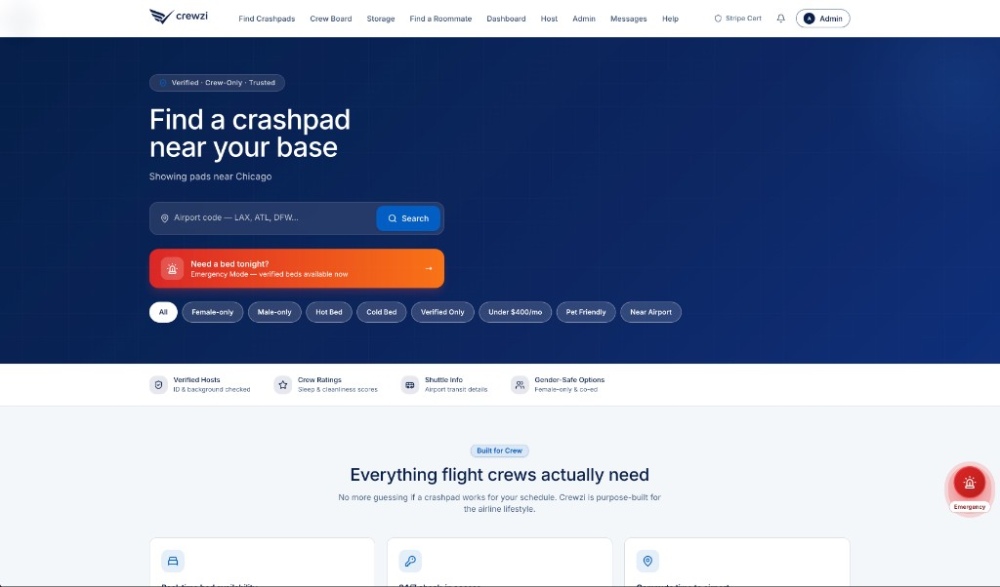
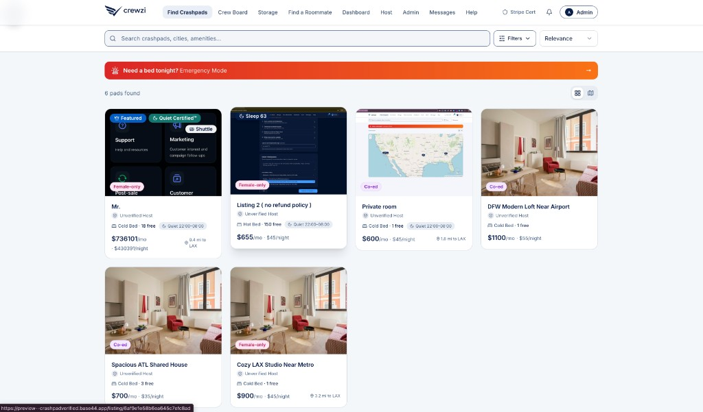
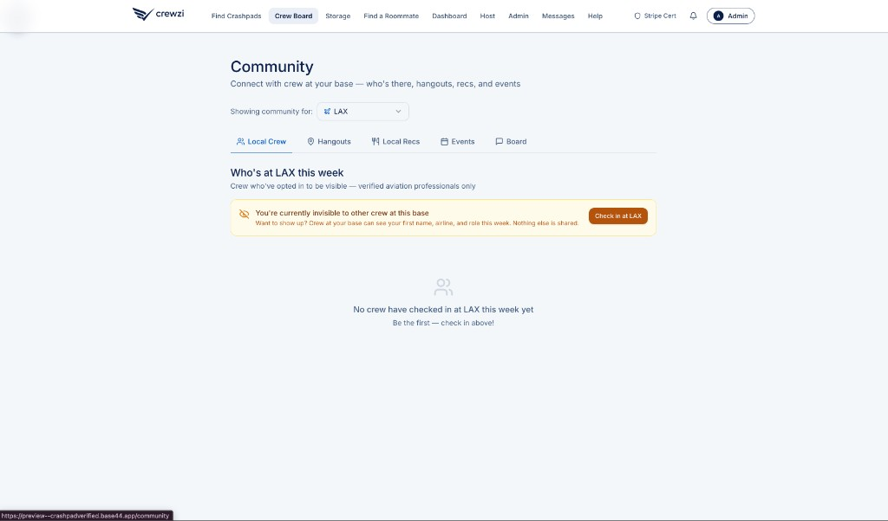
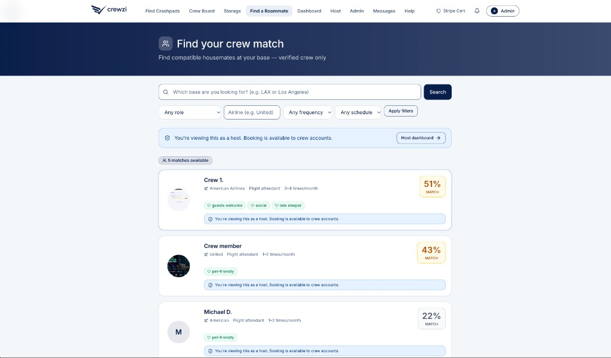
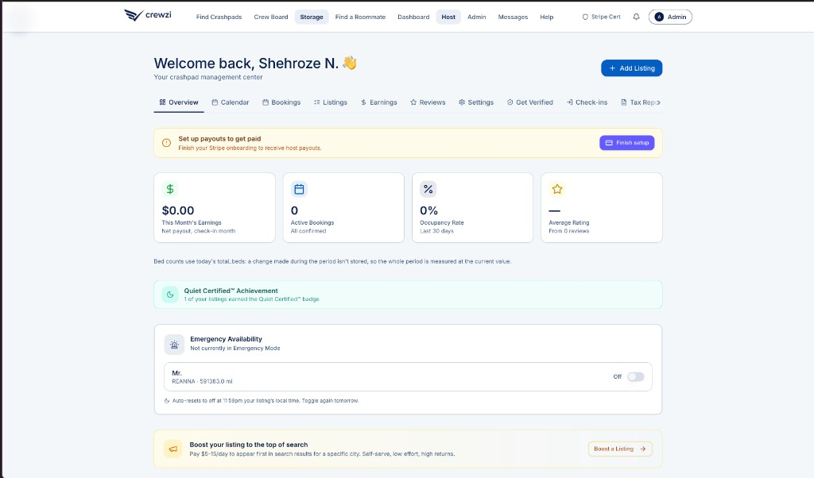
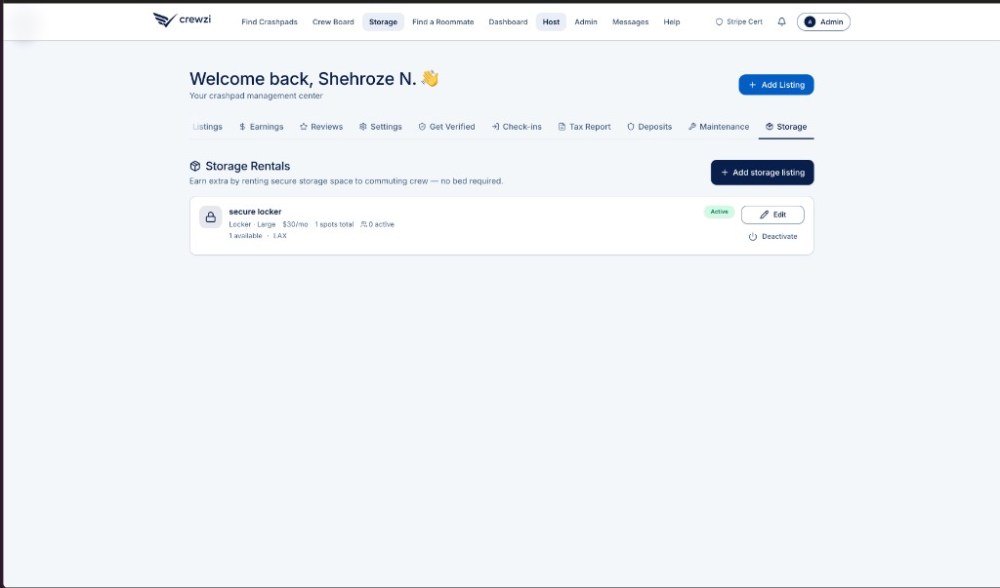
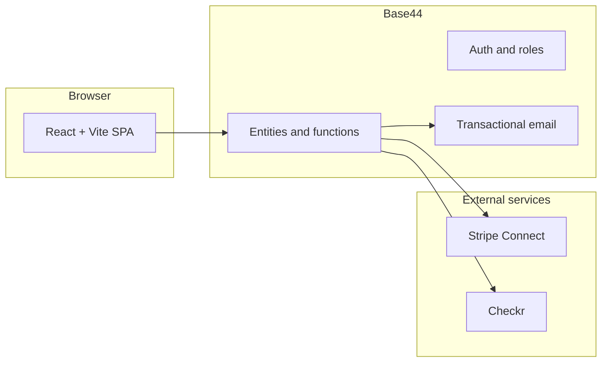

# Crewzi (Crashpad Verified) — Portfolio

> **This public repository is a portfolio showcase only.**  
> The application **source code is private** and is not published here. You can browse this page on GitHub to review scope, screenshots, and technology—**not** to clone or download the product codebase. For collaboration or due diligence, contact the repository owner.

**Crew-first housing marketplace** for airline professionals who need trusted crashpads, storage, roommates, and base-community tools near major airports.

Built as a full product experience: discovery and booking for crew, a host operating center, admin governance, payments, and trust & safety workflows—designed for the realities of line flying (bases, layovers, hot/cold beds, emergency nights).

| | |
|---|---|
| **Portfolio** | You are viewing the public accomplishments page |
| **Live product** | [crashpadverified.base44.app](https://crashpadverified.base44.app) · [getcrewzi.com](https://getcrewzi.com) |
| **Source code** | Private repository — available on request |

---

## Product overview

Crewzi helps **verified airline crew** find short- and medium-term housing (“crashpads”) at crew bases, compare listings with crew-specific filters, book and pay securely, and connect with others at the same base. **Hosts** manage listings, calendars, payouts, check-ins, storage rentals, and verification. **Admins** oversee users, listings, money flows, and platform policy.

### Who it’s for

- **Crew (guests)** — Search by airport/base, filter by gender rules, bed type, price, pets, shuttle access; emergency bed finder; memberships; messaging.
- **Hosts** — List beds and storage, set emergency availability, track earnings and occupancy, handle deposits and maintenance, complete Stripe onboarding and background checks.
- **Platform** — Crew-only community (check-ins, hangouts, events), roommate matching with compatibility scores, educational content (crashpad guides, quiz).

### Core capabilities

| Area | Highlights |
|------|------------|
| **Discovery** | Base/airport search, rich filters (female-only, male-only, hot/cold bed, verified-only, under $/mo, pet-friendly, near airport), map + grid views, listing boost |
| **Booking & money** | Stripe Checkout, Connect host payouts, deposits, extensions, bill split, receipts/credit notes, membership plans, tax reporting hooks |
| **Trust & safety** | Host background checks via **Checkr** (hosted apply flow), crew verification, Quiet Certified™ badges, admin audit logs |
| **Host ops** | Dashboard KPIs, calendar, bookings, listings, reviews, check-ins, maintenance, storage rentals without a bed |
| **Community** | Per-base crew visibility, hangouts, local recs, events, crew board |
| **Roommates** | Base-scoped search, airline/role/schedule filters, match scoring |
| **Emergency** | “Need a bed tonight” mode and host-side emergency toggles on listings |

---

## Screenshots

### Home — search by base with crew-focused filters

### Search results — listings with hot/cold beds, quiet hours, and proximity

### Community — connect with crew at your base (e.g. LAX)

### Find a roommate — verified crew matches at your base

### Host dashboard — earnings, bookings, Stripe payouts, emergency mode

### Storage rentals — hosts monetize locker/garage space for commuting crew

---

## Technology stack (implemented in private codebase)

### Frontend

| Technology | Role |
|------------|------|
| **React 18** | UI application shell, routing, pages |
| **Vite 6** | Dev server, production build |
| **React Router 6** | Client-side navigation |
| **TanStack Query** | Server state and caching |
| **Tailwind CSS 3** | Responsive UI |
| **Radix UI** | Accessible components |
| **Framer Motion** | Motion and transitions |
| **React Hook Form + Zod** | Forms and validation |
| **Recharts** | Analytics charts |
| **React Leaflet** | Map views |

### Payments & trust

| Integration | Role |
|-------------|------|
| **Stripe Connect** | Checkout, host payouts, webhooks |
| **Checkr** | Host background checks (hosted apply) |

### Platform

| Technology | Role |
|------------|------|
| **Base44** | Runtime, entities, server functions, auth, email |
| **TypeScript** | Shared payment and integration logic |

### Engineering quality

Automated payment consistency checks, Stripe Connect certification work, Checkr certification evidence package, and launch-readiness QA (maintained in the private repository).

---

## Architecture (high level)

Multi-role product (**crew**, **host**, **admin**) with a large entity model covering bookings, listings, community, ledgers, and webhook-driven money flows.

---

## Scope at a glance

- **800+** tracked source and configuration files in the private repository (React UI, Base44 entities/functions, email templates, QA scripts)
- **Stripe** and **Checkr** integrations with certification-oriented documentation
- End-to-end flows: search → book → pay → host payout → reviews → community

---

## Contact

**Repository owner:** [Shehroz-Ali](https://github.com/Shehroz-Ali)  
Source access, demos, and technical discussions are available by request only.

**License:** Proprietary. Screenshots and this overview may be shared for portfolio purposes; code is not licensed for public redistribution.
## TestDriver experiment (2026-11-16)
Live app URL for sandbox: https://getcrewzi.com

